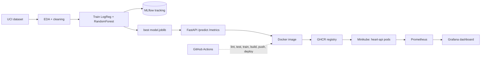

# Heart Disease Risk Prediction - End-to-End MLOps

BITS Pilani MLOps (AIMLCZG523) Assignment 01.
Predicts heart disease risk from the UCI Heart Disease (Cleveland) dataset and serves it as a monitored API on Kubernetes.

## Architecture



## Quick start

```bash
python -m venv .venv && source .venv/bin/activate
pip install -r requirements.txt
python scripts/download_data.py        # real UCI data -> data/raw/heart_raw.csv
python -m src.eda                      # cleaned CSV + figures
python -m src.train                    # trains 2 models, logs to MLflow, saves models/model.joblib
pytest -v                              # unit tests
flake8 .                               # lint
mlflow ui --backend-store-uri sqlite:///mlflow.db --port 5000
uvicorn api.app:app --port 8000        # API docs at /docs
```

Sample request:

```bash
curl -X POST localhost:8000/predict -H 'Content-Type: application/json' \
  -d '{"age":63,"sex":1,"cp":1,"trestbps":145,"chol":233,"fbs":1,"restecg":2,"thalach":150,"exang":0,"oldpeak":2.3,"slope":3,"ca":0,"thal":6}'
```

Docker, Kubernetes, monitoring and lab steps: see [docs/RUNBOOK.md](docs/RUNBOOK.md).

## Layout

| Path | Purpose |
|---|---|
| `scripts/download_data.py` | Downloads the dataset |
| `src/` | data cleaning, preprocessing pipeline, EDA, training |
| `api/app.py` | FastAPI service (`/predict`, `/health`, `/metrics`) |
| `tests/` | pytest unit tests |
| `k8s/` | Deployment, Service, Prometheus, Grafana manifests + dashboard JSON |
| `.github/workflows/ci.yml` | Lint, test, train, Docker build/push, minikube deploy |
| `notebooks/` | EDA, training, inference notebooks |
